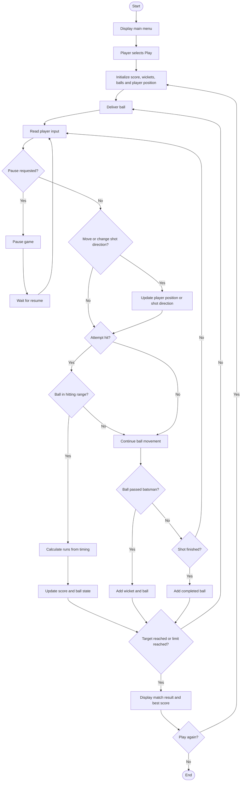

# Activity Diagram — Match Flow

## Description
The match begins from the menu. The game initializes the match values, repeatedly delivers a ball and reads player input. A successful hit adds runs based on timing. A missed delivery can add a wicket. The match ends when the target is reached, three wickets are lost, or 12 balls are completed.
