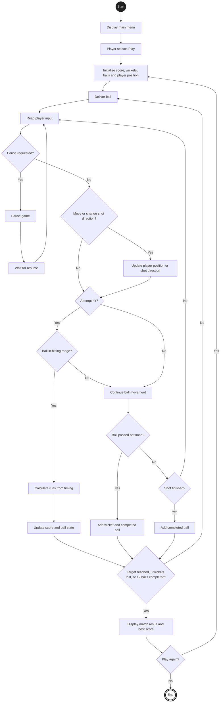

# Activity Diagram — Cricket Champions 4.0 Match Flow

This diagram shows the main match workflow, including player input, ball processing, score updates, pause/resume, and the match-ending checks.

## Description

1. The game starts and displays the main menu.
2. When the player selects Play, the game initializes the match values.
3. The game repeatedly delivers a ball and reads the player's input.
4. The player may pause the game, move the batsman, change shot direction, or attempt a hit.
5. The game checks the hit and ball position, then updates the score or wicket/ball count as appropriate.
6. The match continues until the target is reached, three wickets are lost, or 12 balls are completed.
7. The result is displayed. The player can start another match or exit.

## Important UML notation

- **Filled circle:** Initial node (start).
- **Rounded rectangle:** Activity/action.
- **Diamond:** Decision or condition; outgoing paths are labelled Yes/No.
- **Arrow:** Control flow.
- **Bull's-eye symbol:** Activity final node (end).

> The diagram is a model of the match flow. Keep its conditions and transitions consistent with the actual Python game implementation.
