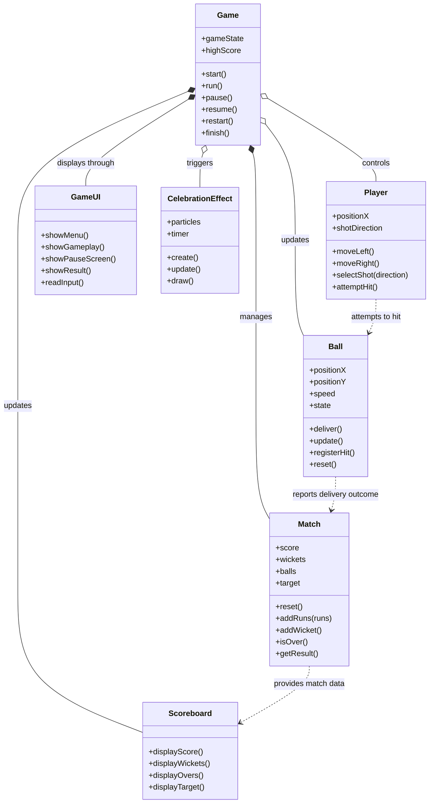

# Class Diagram — Proposed Logical Design

> **Important:** This is a proposed object-oriented design model for the project. The current Python implementation is primarily procedural and uses functions and shared variables; these classes are conceptual responsibilities, not existing Python class declarations.

## Class responsibilities
- **Game:** coordinates the main loop and game states.
- **Match:** stores score, wickets, balls, target, and match result.
- **Player:** stores batsman position and selected shot direction.
- **Ball:** handles delivery movement and hit state.
- **Scoreboard:** presents current match statistics.
- **GameUI:** handles screens and player input.
- **CelebrationEffect:** manages visual effects after boundaries.
