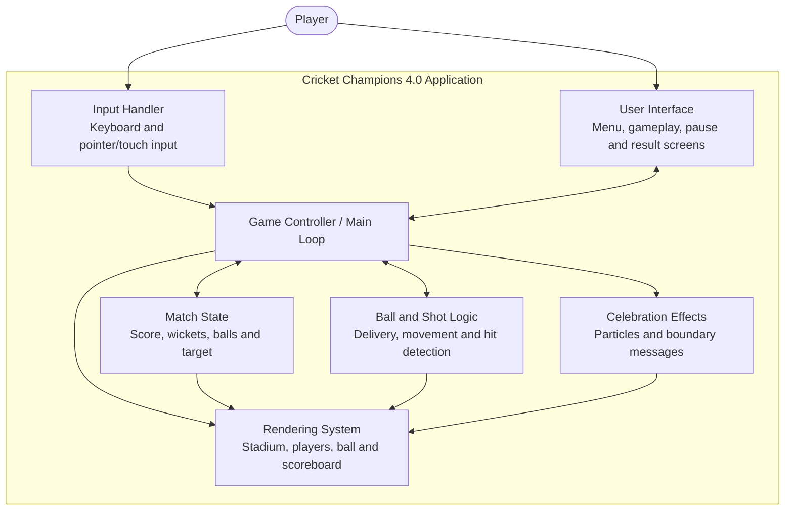

# Component Diagram — Cricket Champions 4.0

## Component description
- **User Interface:** displays the menu, gameplay, pause, and result screens.
- **Input Handler:** receives keyboard and pointer/touch controls.
- **Game Controller:** coordinates the game loop and state transitions.
- **Match State:** stores the score, wickets, balls, and target.
- **Ball and Shot Logic:** updates deliveries, detects hits, and determines outcomes.
- **Rendering System:** draws the stadium, players, ball, controls, and scoreboard.
- **Celebration Effects:** displays particle effects and boundary messages.
