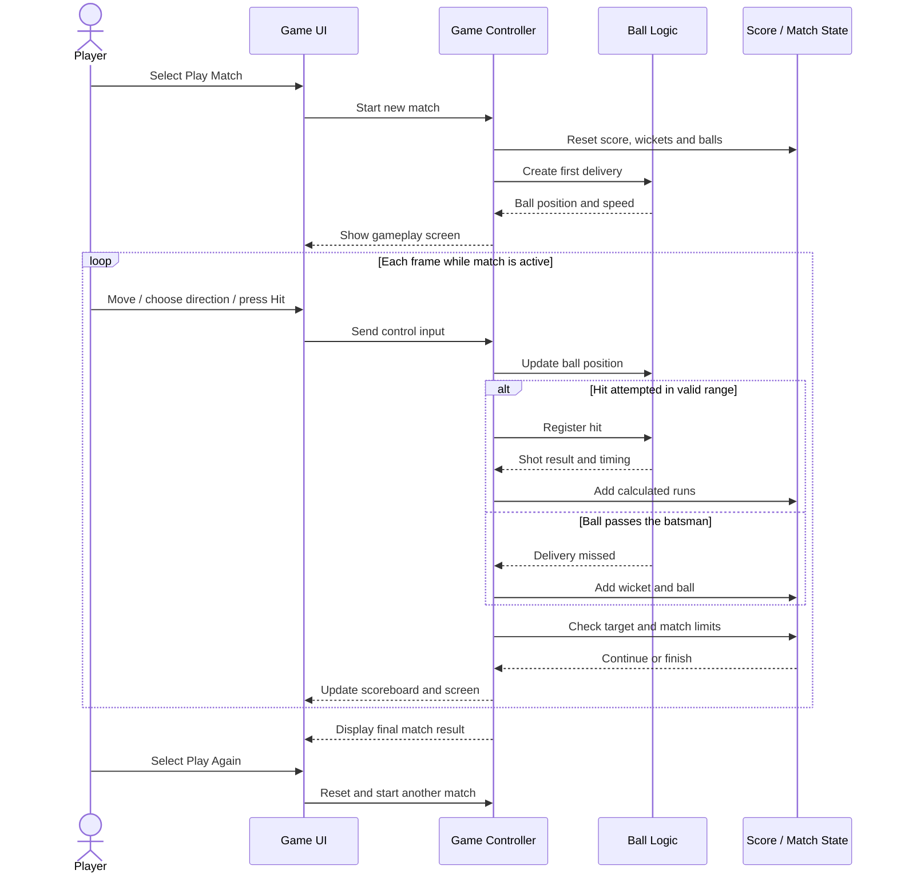

# Sequence Diagram — Playing a Match

## Description
This sequence shows how player input travels through the interface and game controller. Ball logic reports a hit or a missed delivery, the match state updates the score, and the controller decides whether gameplay continues or the result screen should appear.
