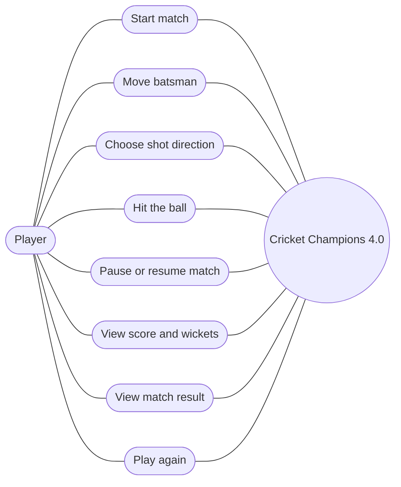

# Use Case Diagram — Cricket Champions 4.0

## Description
- The Player starts a match and controls the batsman.
- The Player can move left or right, select a shot direction, and attempt to hit the incoming ball.
- The game updates and displays runs, wickets, and overs.
- The Player can pause/resume the match and start another match after the result is displayed.
