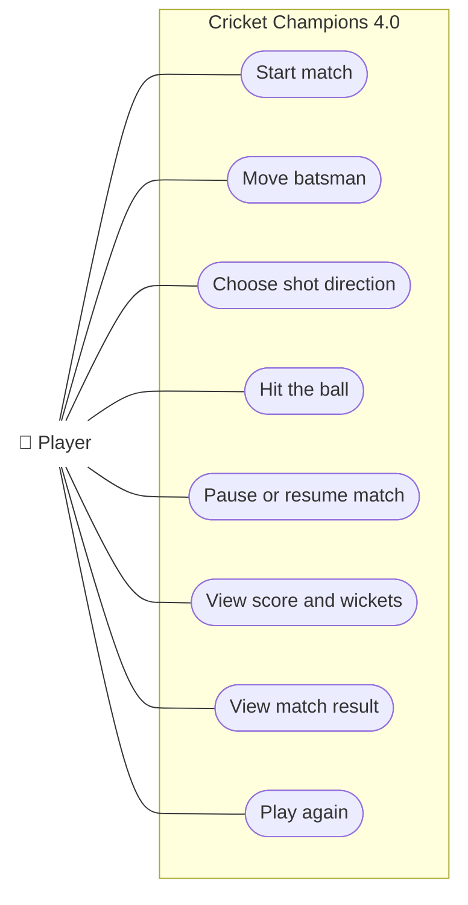

# Use Case Diagram — Cricket Champions 4.0

The **Player** is the actor. **Cricket Champions 4.0** is the system boundary. The ovals represent the use cases (functions available to the player).

> **UML notation note:** The system is shown as a rectangular boundary containing the use cases. The player is outside the boundary because the player is external to the game. Mermaid uses a text node with a person symbol as a visual approximation of the UML stick-figure actor.

## Description

- The Player starts a match and controls the batsman.
- The Player can move left or right, select a shot direction, and attempt to hit the incoming ball.
- The game updates and displays runs, wickets, and overs.
- The Player can pause/resume the match, view the match result, and start another match.

## Main elements

- **Actor:** Player
- **System boundary:** Cricket Champions 4.0
- **Use cases:** Start match, Move batsman, Choose shot direction, Hit the ball, Pause or resume match, View score and wickets, View match result, and Play again.
